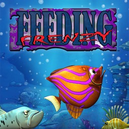

<h1 align=center>Feeding Frenzy: Nintendo Switch port</h1>

<b>feedingfrenzy-nx 1.0.0</b> · <a href="https://chanseyisthebest.github.io/feedingfrenzy-nx-installer/">web installer</a> · <a href="https://github.com/ChanseyIsTheBest/feedingfrenzy-nx/releases/tag/v1.0.0">release</a>

An unofficial native port of the Xbox 360 (Xbox Live Arcade) version of **Feeding Frenzy** (2006) by Sprout Games and
PopCap Games, made by static recompilation with [ReXGlue](https://github.com/rexglue/rexglue-sdk). No emulator. It is
made from the [Bejeweled 3 port](https://github.com/ChanseyIsTheBest/bejeweled3-nx)'s code.

This repository contains no game files. You need your own copy of the game, from your own Xbox 360: the Xbox Live
Arcade game's content package (`Content/0000000000000000/584107F1/000D0000/F2727A719711C4E6BE4B402D70C1FA917A42E7C658`).

## Playing it on the Switch

1. Open the web installer: **https://chanseyisthebest.github.io/feedingfrenzy-nx-installer/**
2. Give it the content package (or a folder that holds it) and press **Create feedingfrenzy-nx.zip**. Everything runs
   in your browser; your game files never leave your computer.
3. Extract `feedingfrenzy-nx.zip` into `sdmc:/switch/`.
4. Start it with a game override (hold **R** while starting an installed title) or a forwarder.

- A forwarder must be set to a **39-bit address space**. Album applet mode does not give the game enough memory.
- The first time you play, the game's shaders are compiled for the console, so it can stutter for a moment at the
  start. Later sessions are smooth.

## Features

- 1280x720 in handheld and docked mode, 60 fps.
- Renut's Direct3D-level renderer ([reNut](https://github.com/masterspike52/reNut) by masterspike52) on deko3d, the
  Switch's own graphics API.
- The left stick moves your fish; face buttons work by position, as on the Xbox 360 pad (B is the Xbox's A, A is B,
  Y is X, X is Y; + is Start, − is Back).
- No log files are kept; only a crash writes `logs/rex/rex_crash.log`.

`feedingfrenzy.toml`, next to the NRO, holds your options (delete it to get the defaults back):
`feedingfrenzy_language` (empty: the console's language, English when the game does not have it; or `en`, `de`, `es`,
`fr`, `it`, `ja`, `pt`), `input_xbox_layout` (`false` for buttons by letter), `input_joycon_sideways` and
`input_joycon_sideways_stick` (a single Joy-Con held sideways, on by default).

## Known issues

- Xbox LIVE (leaderboards, online play) is not available.
- No multiplayer (the game has none) and no touch controls.

## Building

Needs Windows with LLVM clang 20 and the VS 2022 Build Tools (PC build); devkitA64, libnx and deko3d from
[devkitPro](https://devkitpro.org) (Switch), with uam and SPIRV-Cross built for the PC (`tools/deko3d_build_tools.sh`);
Python; and your own copy of the game. All steps are in [docs/building.md](docs/building.md).

More: [docs/feedingfrenzy-notes.md](docs/feedingfrenzy-notes.md) (the game's code and every change of the port),
[docs/optimising-functions.md](docs/optimising-functions.md), [docs/hand-natives.md](docs/hand-natives.md),
[docs/bejeweled3-notes.md](docs/bejeweled3-notes.md) (the code this port is made from).

## Credits and license

- **Sprout Games and PopCap Games**: creators of Feeding Frenzy.
- **ChanseyIsTheBest**: this port and the ports it is made from (bejeweled3-nx, the Peggle ports).
- **[Tom Clay](https://github.com/rexglue/rexglue-sdk)**: the ReXGlue SDK, built on the work of the
  **[Xenia](https://xenia.jp)** team.
- **[StevensND](https://github.com/StevensND/nfsmw-nx)**: nfsmw-nx (the SDK's Switch layer, much of the method) and
  [nfsmw-nx-installer](https://github.com/StevensND/nfsmw-nx-installer), which this installer page is built on.
- **[masterspike52](https://github.com/masterspike52/reNut)**: reNut, the Direct3D-level renderer the port draws with
  (reuse permitted by its author).
- **banjo-nx** (Banjo-Kazooie: Nuts & Bolts Switch port): Renut's Switch port, plume's deko3d back end, the shader
  generator and its optimisations.
- **[renderbag](https://github.com/renderbag/plume)**: plume; **[fincs](https://github.com/devkitPro/uam)** and
  devkitPro: deko3d and uam.
- **[hedge-dev](https://github.com/hedge-dev/XenosRecomp)**: XenosRecomp, the Xenos shader translator.
- **[devkitPro](https://devkitpro.org) and [switchbrew](https://github.com/switchbrew/libnx)**: devkitA64 and libnx.
- The sibling ports, which share their fixes, and the libraries listed in [THIRD_PARTY_NOTICES.md](THIRD_PARTY_NOTICES.md).

An unofficial, fan-made port. No affiliation with Sprout Games, PopCap Games, Electronic Arts, Microsoft or Nintendo.
"Feeding Frenzy" is a trademark of PopCap Games / Electronic Arts; the icon (here and in the NRO) is the game's artwork,
© PopCap Games. Apart from it, this repository contains no assets or program code from the original game; you provide
your own legally obtained copy, and everything made from it (`assets/`, `app/generated/`, the game pack) is made on
your own computer. Running homebrew requires custom firmware, which violates Nintendo's ToS and can get a console
banned.

GPL-3.0 (see [LICENSE](LICENSE)), like the ports it builds on; the SDK keeps its BSD-3-Clause license (see
[THIRD_PARTY_NOTICES.md](THIRD_PARTY_NOTICES.md)).
